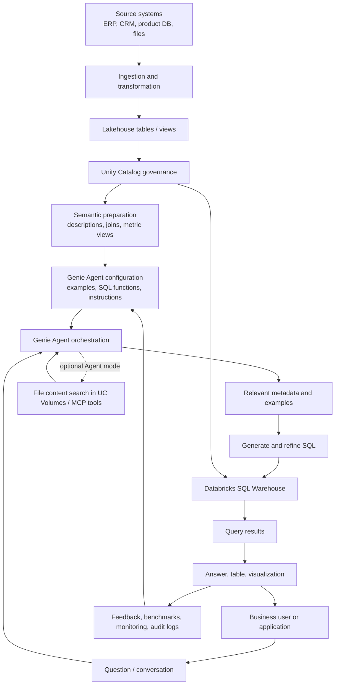
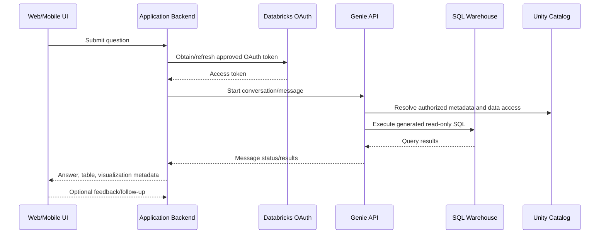

# Databricks Genie: End-to-End Architecture and Implementation Guide

**Scope:** AWS Databricks documentation, reviewed 27 October 2026  
**Audience:** Data engineers, analytics engineers, developers, data analysts, platform administrators  
**Purpose:** Explain the full lifecycle from source data to a governed, tested, production-ready Genie experience.

> **Terminology note:** Databricks documentation now calls the domain-specific environments formerly known as *Genie Spaces* **Genie Agents**. Some APIs and audit events still use names such as `space_id` and `genie/spaces`; this guide explains both.

## 1. Executive summary

Databricks Genie lets users ask questions about business data in natural language. Genie Agents are configured for a specific business domain using Unity Catalog data, metadata, examples, SQL expressions, and instructions. Genie uses that context to generate SQL, run it through a SQL warehouse, and return results and visualizations.

Genie is not simply an LLM connected directly to a database. It is a compound AI experience built around governed data, semantic context, query generation, SQL execution, access control, and evaluation.

**Recommended enterprise principle:** Build trustworthy data and business definitions first; configure Genie second; evaluate it with real questions before rollout; monitor and improve it continuously.

## 2. Product map: do not confuse these names

| Product | Main purpose | Typical user |
|---|---|---|
| **Genie One** | A unified place to discover and interact with governed data assets, dashboards, and apps | Business user |
| **Genie Agents** | Domain-specific conversational analytics configured with trusted data, metrics, and business rules | Analyst / data team and business users |
| **Genie Code** | Developer and data-practitioner assistant for coding, pipelines, dashboards, and workspace tasks | Developer / data engineer |

This guide focuses mainly on **Genie Agents**, because they are the domain-specific assistants that teams configure and connect to applications.

## 3. Reference architecture



The diagram is a conceptual architecture, not a claim about Databricks' private internal implementation. In the standard structured-data path, Genie uses metadata and configured context to generate a query, and the SQL warehouse executes it. Agent mode can take multiple steps and can use additional supported sources.

## 4. End-to-end pipeline at a glance

| Stage | Goal | Main output | Quality gate |
|---|---|---|---|
| 1. Define scope | Pick one business domain and its questions | Scope and success criteria | Questions are answerable from available data |
| 2. Ingest data | Bring source data into the lakehouse | Managed/external tables or views | Freshness and completeness checks pass |
| 3. Model data | Clean, join, and standardize records | Curated analytical model | Business totals reconcile |
| 4. Govern data | Register assets and permissions | Unity Catalog objects and grants | Least-privilege access verified |
| 5. Define semantics | Explain tables, columns, metrics, and joins | Trusted business context | Business owner approves definitions |
| 6. Configure agent | Attach sources and add examples/instructions | Genie Agent | Scope is focused and unambiguous |
| 7. Test | Evaluate realistic questions and expected answers | Benchmark results | Accuracy meets agreed threshold |
| 8. Release | Share or integrate the agent | User-facing experience/API | Security and operational checks pass |
| 9. Monitor | Review errors, feedback, usage, and drift | Improvement backlog | Issues have owners and follow-up dates |
| 10. Maintain | Update data, context, and tests | Versioned, improved agent | Regression tests pass after changes |

## 5. Stage 1 — Define the use case

Start with one domain, such as sales performance, inventory, support operations, or finance.

Write down:
- Who will use the agent.
- Which business questions it should answer.
- Which tables contain the authoritative facts.
- The approved definitions of key metrics.
- Questions it must decline or clarify.
- Expected response time and accuracy.
- Which users may access which data.

**Example:** A sales agent answers questions about revenue, units sold, returns, store, and region. It should not be expected to answer HR questions unless those sources and permissions are deliberately configured.

Do not start by attaching every table in the company. A focused scope makes metadata and testing easier. Databricks recommends starting small and aiming for five or fewer tables where practical, even though the current documented maximum is 50 tables, views, or metric views per Genie Agent.

## 6. Stage 2 — Ingest and prepare data

Genie is not a replacement for the company's data engineering pipeline. Prepare reliable data before connecting it.

A typical lakehouse pattern is:

1. **Source:** ERP, CRM, application databases, event streams, files, or other supported sources.
2. **Ingest:** Use the company's chosen Databricks ingestion tools and scheduled or incremental pipelines.
3. **Raw/bronze layer:** Keep source-aligned data for traceability where appropriate.
4. **Clean/silver layer:** Standardize types, timestamps, identifiers, duplicates, and quality rules.
5. **Curated/gold layer:** Build business-ready tables, views, and metric views.
6. **Validate:** Check row counts, freshness, nulls, referential integrity, and reconciled business totals.
7. **Register/govern:** Make the intended assets available through Unity Catalog.

**Example:** Raw order events may include cancelled, test, and duplicate orders. The curated sales model should apply documented rules so Genie does not calculate revenue from the wrong records.

### Data-model guidance
- Prefer descriptive names and clear column meanings.
- Use views to simplify complicated joins or hide irrelevant columns.
- Define primary/foreign-key relationships when appropriate and maintain reliable join logic.
- Avoid ambiguous columns such as `status`, `value`, or `date` without descriptions.
- Use metric views when a business metric must be defined once and reused consistently.
- Reconcile important totals against existing trusted dashboards or SQL reports.

## 7. Stage 3 — Unity Catalog and security

Unity Catalog is the governance layer for data objects used by Genie. It governs discoverability and permissions for the tables, views, metric views, functions, and supported file assets used by an agent.

Before configuring Genie:
1. Confirm the workspace uses Unity Catalog.
2. Register the required tables/views/metric views.
3. Add meaningful table and column comments/descriptions.
4. Grant only the required `SELECT` privileges to intended users/groups.
5. Apply row filters and column masks where different users should see different records or fields.
6. Test with accounts representing different roles.
7. Verify the SQL warehouse and Genie Agent access settings.

### Important credential distinction
For Genie Agents, warehouse compute access and data access are distinct:
- The warehouse uses the compute credentials embedded by the author who configured the warehouse.
- Data access is evaluated using the end user's own Unity Catalog identity.
- Row filters and column masks defined in Unity Catalog are enforced for the user.
- Users still need the appropriate Genie Agent permission and data privileges.

For API integrations authenticated as a service principal, grant the service principal only the permissions the integration actually needs. Decide explicitly whether the application should act as the individual user or as a controlled service identity; do not accidentally broaden data access.

## 8. Stage 4 — Build the semantic layer and knowledge context

This is one of the most important stages. Genie must understand what business words mean in your data.

### 8.1 Unity Catalog metadata
Add accurate descriptions to:
- Tables and views.
- Columns and their units.
- Primary/foreign-key relationships where applicable.
- Important categorical values and business codes.

### 8.2 Agent-level knowledge store
Configure agent-specific context such as:
- Column descriptions and synonyms.
- Join relationships.
- SQL expressions for measures, dimensions, and filters.
- Prompt-matching settings.

This agent-level context does not replace or rewrite the underlying Unity Catalog metadata.

### 8.3 Metric views and business definitions
Define important metrics centrally when possible. For example:

- **Net revenue:** Revenue after approved discounts and returns.
- **Completed order:** An order whose status meets the company's approved completion rule.
- **Active customer:** A customer meeting the agreed activity definition and time window.

The definitions above are examples only. The business owner must decide the real rules.

A metric view can define measures and dimensions once so different questions can group and filter the same metric consistently.

### 8.4 Example SQL queries
Add tested SQL examples for frequent or ambiguous questions. Write the example question the way users naturally ask it and pair it with SQL that has been validated against expected results.

Useful examples include:
- Total revenue by month.
- Top products by net revenue.
- Return rate by region.
- Average order value.
- Month-over-month change.

Prioritize structured SQL expressions and examples over long blocks of general text instructions.

### 8.5 SQL functions and trusted assets
Use a Unity Catalog SQL function when reusable business logic cannot be expressed adequately as a simple example query. Trusted assets can provide verified logic for supported questions. Have a data owner review these definitions.

### 8.6 General instructions
Use concise instructions for global rules that cannot be expressed better as metadata, SQL expressions, or examples. Examples:
- State the currency and timezone used.
- Ask for a date range if it is required but missing.
- Do not treat cancelled orders as completed orders.
- Explain when the data does not contain enough information.
- Use a specific rounding convention.

Avoid contradictory instructions. If the instructions say to exclude cancelled orders, the example SQL must do the same.

## 9. Stage 5 — Create and configure the Genie Agent

A typical author workflow:

1. Open **Genie Agents** in the Databricks workspace.
2. Create a new agent and select the required Unity Catalog data objects.
3. Give it a clear name and purpose.
4. Select a supported Pro or serverless SQL warehouse.
5. Review table and column descriptions and sample data.
6. Configure joins, SQL expressions, measures, filters, and synonyms.
7. Add verified example SQL queries and SQL functions where appropriate.
8. Add concise general instructions.
9. Add common/sample questions for discoverability.
10. Save and test before sharing.

Databricks can provide suggestions through Genie Code during setup. Treat generated descriptions and query suggestions as drafts: review them for correctness before accepting them.

### Data selection rule
Only attach the sources the agent should use. Genie does not automatically query every object in Unity Catalog just because it exists or is mentioned in an instruction.

## 10. Stage 6 — Runtime request pipeline

### Chat mode: one-question analytics
Best for a focused question that can usually be answered by one SQL query.

1. User asks a question.
2. Genie interprets the request and identifies relevant metadata, instructions, SQL examples, and conversation context.
3. Genie generates SQL.
4. The SQL warehouse executes the generated read-only query.
5. Genie returns the query/result table and, where useful, a visualization.
6. The user can ask a follow-up in the same conversation.

### Agent mode: complex analysis
Best for multi-step questions, exploratory investigations, or questions involving supported unstructured files or external tools.

1. Genie creates a research plan.
2. It breaks the request into smaller questions.
3. It executes multiple SQL queries and/or uses configured supported sources.
4. It reviews intermediate results and iterates.
5. It returns a report with findings and supporting tables, visualizations, and citations where supported.

**Mode selection:**
- **Chat mode:** Fast, focused structured-data queries.
- **Standard Agent mode:** Deeper multi-step investigation; usually slower.
- **Agent mode Flash (Beta):** Faster, more concise multi-step experience where available; it spends less time reasoning.

Use the mode that fits the question. Do not use multi-step Agent mode for every simple count or sum.

## 11. Optional document and external-source pipeline

Traditional Chat mode focuses on structured data. For documents and external systems, use the supported Agent mode capabilities and confirm feature availability in your workspace/region.

### Files stored in Unity Catalog volumes
The documented file-analysis capability is in Beta. At a high level:
1. Store supported files in a supported Unity Catalog managed volume.
2. Attach the volume to the Genie Agent.
3. Databricks content search parses and indexes files and keeps the index synchronized as files change.
4. The user asks a question in Agent mode.
5. The agent retrieves relevant file content and can combine it with structured data.
6. The answer can include citations to source-file pages where supported.

Current documented constraints include a maximum of 10 volumes per agent, up to 10,000 files per indexed volume, and skipping files larger than 100 MB or over 500 pages. Supported file types and regional/cross-Geo requirements must be checked in the current documentation before deployment.

### External systems such as Google Drive or Slack
Use supported MCP connectors in Agent mode where available. This is a different integration from indexing files in a Unity Catalog volume. Review connector permissions, data handling, and beta status before enabling it.

### Local CSV/Excel/PDF upload
File upload supports quick analysis in a conversation and is useful for ad hoc exploration. It is not the same as a governed, continuously synchronized enterprise knowledge source.

## 12. Stage 7 — API integration into an application

The Genie Agents API supports:
- **Chat mode APIs:** Stateful natural-language data conversations and follow-up questions.
- **Agent mode APIs:** Programmatic multi-step analysis and reports.
- **Management APIs:** Programmatic agent creation, configuration, and deployment across workspaces.

### Suggested application flow



This is a conceptual request flow; exact endpoints and response schemas differ by API mode and API version.

### Integration checklist
1. Choose OAuth for users (U2M) when the application should act with the signed-in user's identity and a browser-based flow is appropriate.
2. Use OAuth for service principals (M2M) when a headless service integration is required; grant the service principal only necessary access.
3. Store credentials securely on the backend. Never put a Databricks secret/token in browser or mobile app code.
4. Store the Genie Agent ID, workspace URL, and approved configuration in environment/secret management.
5. Start a conversation or send a prompt using the appropriate Chat mode or Agent mode endpoint.
6. Handle asynchronous states. Poll every 1–5 seconds initially, increase delays with exponential backoff, and stop at a defined timeout. Databricks' API guide recommends a 10-minute polling limit for most queries.
7. Handle completed, failed, cancelled, and timed-out states.
8. Parse the response according to the documented API schema. Do not assume every message contains a SQL result; some may be clarification, text, or other content.
9. Return only the content the application is authorized to expose.
10. Log request IDs and statuses without logging secrets or unnecessarily storing sensitive result data.
11. Implement rate limits, retries for transient failures, and user-friendly timeout messages.
12. Create a fresh conversation for each new application session where appropriate; reuse a conversation only when follow-up context is intentional.

### API version caution
Databricks has Chat mode and Agent mode API patterns and older endpoint names. Read the current AWS REST API reference before implementing. The term “Genie Space” and the `/api/2.0/genie/spaces/...` path may still appear in APIs even though the UI calls the object a Genie Agent.

## 13. Stage 8 — Evaluation and quality gates

Do not release an agent based only on a few successful demo questions.

### Build a benchmark set
Create realistic questions from actual user workflows:
- Simple totals and counts.
- Date boundaries and timezones.
- Filters and status rules.
- Joins across tables.
- Grouping and ranking.
- Synonyms and alternate phrasings.
- Ambiguous questions that should trigger clarification.
- Questions the agent should not answer due to missing data or permissions.

For Chat mode benchmarks, supply a validated SQL answer so results can be compared automatically where supported. Review the SQL and result semantics, not just whether the query executed. For Agent mode, use evaluation notes where appropriate and manually inspect important answers.

Databricks documentation currently describes up to 500 benchmark questions per agent and recommends testing multiple phrasings of the same question. Aim for at least five tested example SQL queries and five benchmark questions as a starting point, then expand based on risk and usage.

### Quality gates before release
- SQL compiles and executes.
- Result values match trusted SQL for the test set.
- Date, join, filter, and aggregation logic is correct.
- Business definitions match approved definitions.
- User permissions and row/column security behave as expected.
- Ambiguous questions are clarified rather than guessed.
- No unsupported claims are made when data is missing.
- Latency and query cost are acceptable.

## 14. Stage 9 — Monitoring and continuous improvement

Genie Agent curation is an ongoing process.

Monitor:
- User questions and generated SQL.
- Query failures and timeouts.
- User feedback and requests for review.
- Benchmark scores after context changes.
- Data freshness and pipeline failures.
- Warehouse latency and spend.
- API errors and response states.
- Permission failures and audit events.

### Improvement loop
1. Find a low-rated or incorrect response.
2. Reproduce the question and inspect generated SQL and query results.
3. Identify the cause: missing metadata, bad join, ambiguous metric, poor example, data quality, or permissions.
4. Fix the root cause in the data model or agent context.
5. Add a benchmark or alternate phrasing to prevent regression.
6. Rerun benchmarks.
7. Release the change only after the expected behavior is verified.

Do not try to fix every problem with a longer prompt. Fix incorrect source data in the pipeline, inconsistent metrics in the semantic layer, and query-pattern problems with verified examples or expressions.

## 15. Production deployment and CI/CD

For multiple environments, use a controlled lifecycle:

```text
Development agent
      |
      v
Curate + test + benchmark
      |
      v
Review context and permissions
      |
      v
Export/version configuration
      |
      v
Deploy to staging workspace
      |
      v
Run regression and security tests
      |
      v
Approve release
      |
      v
Deploy to production workspace
      |
      v
Monitor + collect feedback
      |
      +----> Update backlog
```

Use the Management APIs and supported Databricks tooling for repeatable configuration and deployment. Keep configuration changes in version control where feasible. Use separate development/staging/production assets and least-privilege identities. Avoid manual-only changes that cannot be reproduced.

Before every deployment:
- Compare agent sources and settings.
- Validate semantic definitions and example SQL.
- Run benchmarks.
- Verify grants and row/column policies.
- Confirm the intended warehouse and budget controls.
- Document rollback steps.

## 16. Operational security checklist

- [ ] Unity Catalog is the authoritative permission layer for data.
- [ ] Agent sources are limited to the intended domain.
- [ ] Users have only required `SELECT`/volume access.
- [ ] Row filters and column masks are tested with representative identities.
- [ ] API tokens and OAuth secrets are never embedded in client code.
- [ ] Service principals use least privilege and are rotated/managed appropriately.
- [ ] Sensitive prompts/results are not unnecessarily written to application logs.
- [ ] Audit logs and query history are available to authorized operators.
- [ ] Usage budgets, warehouse sizing, and alerts are configured.
- [ ] External connectors and file analysis are reviewed for permissions, region, and preview/beta constraints.

## 17. Troubleshooting guide

| Symptom | Likely causes | What to check |
|---|---|---|
| Genie returns empty results | User lacks `SELECT`, row filters remove rows, or no matching data | Test the same query/data as that user; inspect Unity Catalog grants and policies |
| Wrong revenue or count | Unclear metric definition, duplicate rows, incorrect filters, bad join | Reconcile curated data and metric-view/SQL definitions |
| Wrong table or column | Poor names/comments, too many sources, ambiguous columns | Improve descriptions; narrow sources; add examples |
| SQL fails | Unsupported syntax, wrong column type, incorrect join, bad example | Inspect generated SQL and query error; correct context/example |
| Follow-up changes answer unexpectedly | Conversation context or ambiguous phrasing | Test a fresh conversation and make the question/definitions explicit |
| File questions do not work | Chat mode selected, unsupported file/volume, permissions, feature unavailable in region | Use Agent mode; check Beta prerequisites, volume type, file limits, `READ VOLUME`, and region requirements |
| API times out | Long-running query, too-frequent polling, overloaded compute | Add bounded polling/backoff; check query history and warehouse performance |
| Results differ between users | Different Unity Catalog permissions or row/column policies | Test with each role and verify security policy behavior |
| Performance/cost worsens | Complex SQL, broad scope, expensive warehouse, unnecessary Agent mode | Simplify model, narrow agent scope, use Chat mode for simple questions, inspect warehouse usage |

## 18. Recommended implementation plan

### Phase 1 — Reliable data
- Select one business domain.
- Build clean curated tables/views.
- Register them in Unity Catalog.
- Validate freshness, joins, and totals.

### Phase 2 — Semantic context
- Write table/column descriptions.
- Define key metrics and filters.
- Add join relationships.
- Create at least five verified SQL examples.
- Add concise instructions.

### Phase 3 — Evaluation
- Build a benchmark set from real questions.
- Include alternate phrasings and edge cases.
- Test data access for different user roles.
- Fix errors and rerun tests.

### Phase 4 — Release
- Share with a small pilot group.
- Integrate through the API only if needed.
- Apply rate limits, timeout handling, and secure OAuth.
- Document operational ownership.

### Phase 5 — Operate
- Review feedback and audit logs.
- Track accuracy, latency, cost, and data freshness.
- Update examples and semantics.
- Run regression benchmarks after every change.

## 19. Key design decisions

| Decision | Recommended default |
|---|---|
| Data scope | One focused business domain per agent |
| Data model | Curated tables/views; metric views for reusable metrics |
| Context strategy | Good metadata first, then SQL expressions/examples, then concise instructions |
| Simple questions | Chat mode |
| Complex investigation | Standard Agent mode |
| Faster exploratory answers | Flash only if available and suitable; note Beta status |
| Documents | Agent mode with supported Unity Catalog volumes when requirements fit |
| External tools | Supported MCP connectors with explicit security review |
| Production API | OAuth U2M for user identity flows; M2M service principal for approved headless integrations |
| Accuracy | Benchmarks plus manual review of high-risk answers |
| Change management | Versioned configuration, staging tests, controlled rollout |
| Governance | Unity Catalog least privilege, row/column policies, audit and query monitoring |

## 20. Official documentation references

The product evolves quickly. Verify current limits, API schemas, availability, billing, and Beta/Preview status before implementation.

1. [Genie overview](https://docs.databricks.com/aws/en/genie/)
2. [Genie Agents concepts and response flow](https://docs.databricks.com/aws/en/genie-agents/concepts)
3. [Create and manage a Genie Agent](https://docs.databricks.com/aws/en/genie-agents/set-up)
4. [Curate an effective Genie Agent](https://docs.databricks.com/aws/en/genie-agents/best-practices)
5. [Tune Genie Agent quality](https://docs.databricks.com/aws/en/genie-agents/tune-quality)
6. [Test and monitor a Genie Agent](https://docs.databricks.com/aws/en/genie-agents/monitor)
7. [Use the Genie Agents API](https://docs.databricks.com/aws/en/genie-agents/conversation-api)
8. [Unity Catalog metric views](https://docs.databricks.com/aws/en/uc-semantics/metric-views/)
9. [Analyze files in volumes with a Genie Agent](https://docs.databricks.com/aws/en/genie-agents/volumes)
10. [Connect a Genie Agent to external tools and sources](https://docs.databricks.com/aws/en/genie-agents/external-tools)
11. [Monitor Genie Agent usage with audit logs](https://docs.databricks.com/aws/en/genie-agents/audits-alerts)
12. [Genie API reference](https://docs.databricks.com/api/genie)

---

## Final takeaway

The reliable path is:

**Source systems → ingestion and quality checks → curated tables/views → Unity Catalog governance → semantic definitions and examples → Genie Agent → SQL/Agent-mode execution → answer → benchmark → monitor → improve.**

The strongest Genie implementations are not the ones with the longest instructions. They are the ones with trustworthy data, clear business definitions, focused source selection, verified SQL examples, strong permissions, and a continuous evaluation loop.
